# traday

**A day-trading bot for one setup, the opening-range breakout. It trades on paper by default and
on your DEGIRO account when you switch it on. You control it with a few buttons from the web
dashboard, the native Mac app or your iPhone, and you can review every buy and sell, day by day,
with its profit. All three are views of the same bot, so what you do in one shows up in the others.**

> [!NOTE]
> **The source code of this project is private.** This repository is its public showcase: the
> README, screenshots and every source file with its types and function signatures, but none of the
> code inside them. If you'd like a demo or to talk about the project, open an issue.

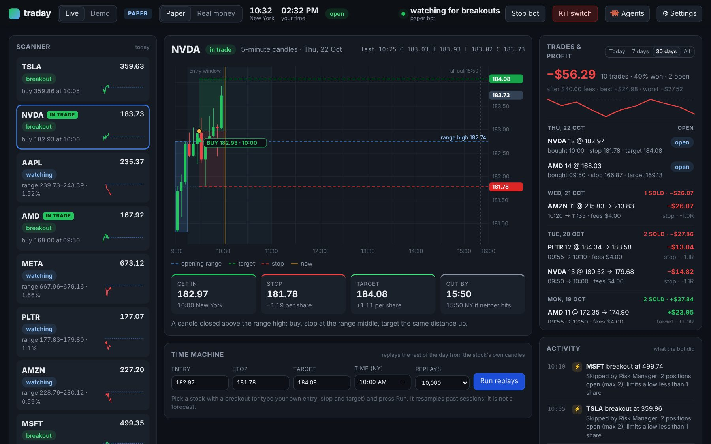

Every US trading day traday scans your watchlist and waits for a stock to break out of its first
15 minutes. It checks the trade against your limits, then buys and places the stop. It takes the
profit at the target, and anything still open is sold by 15:50 New York time. Every step goes into
a journal and, if you like, to your phone. Inside, it is a team of [11 small agents](#the-11-agents),
each with one job, like the ones in the reel it started from.

> [!WARNING]
> **Not financial advice.** traday follows rules you set, and it can lose money. DEGIRO has no
> official trading API (traday uses the community library degiro-connector). The backtests will show
> you that this setup is close to a coin flip before costs. Paper-trade it for weeks first, and read
> [Will it make money?](#will-it-make-money) before you put a cent in.

**Contents:**
[What it looks like](#what-it-looks-like) ·
[The 11 agents](#the-11-agents) ·
[Every trade, every day](#review-every-trade-and-the-profit) ·
[How it works](#how-it-works) ·
[Will it make money?](#will-it-make-money) ·
[Background](#background)

---

## What it looks like

All pictures on this page show the real dashboard, playing a made-up trading day.

<table>
<tr>
<td width="50%">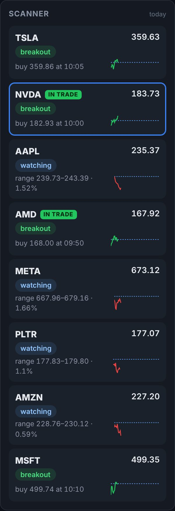<br><b>Scanner.</b> Every stock on your watchlist: its opening range, and whether it is building, watching, has broken out or is in a trade.</td>
<td width="50%">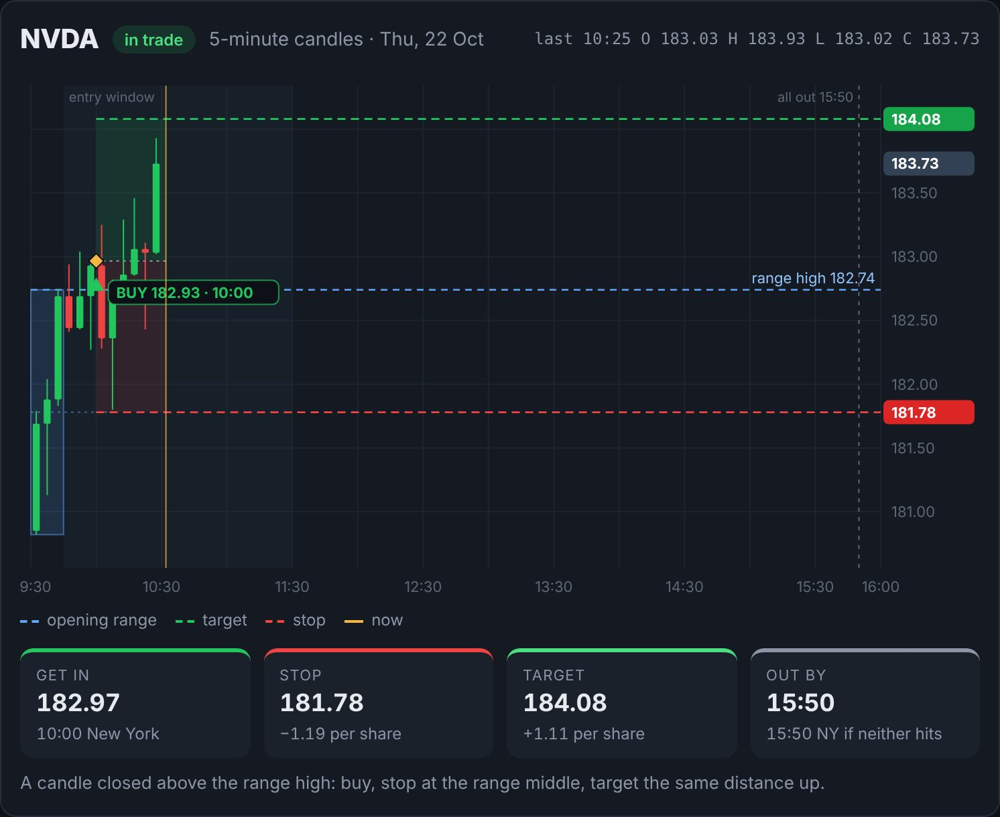<br><b>Chart.</b> 5-minute candles with the opening range (blue), the buy, the target (green) and the stop (red). Underneath: the plan in numbers.</td>
</tr>
<tr>
<td>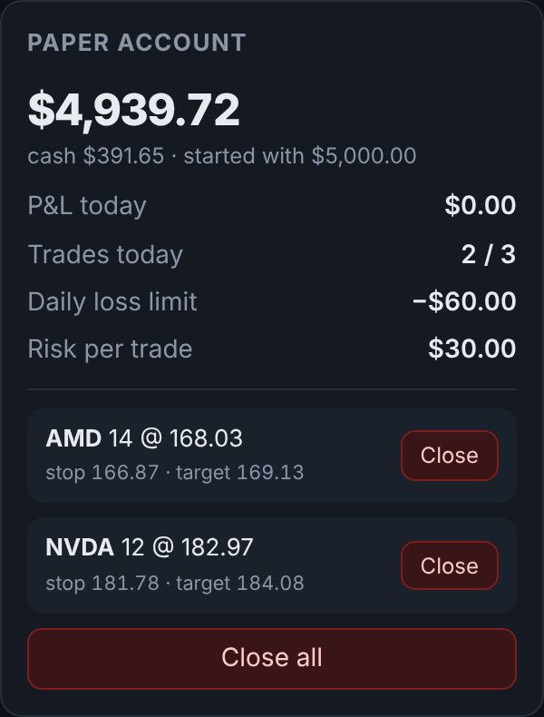<br><b>Account.</b> Cash, today's result, your limits, and every open trade with its own <b>Close</b> button.</td>
<td>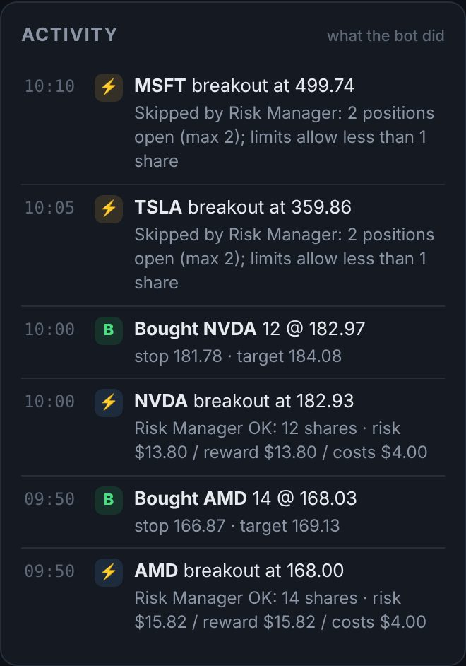<br><b>Activity.</b> Everything the bot did and why, including the breakouts the Risk Manager skipped.</td>
</tr>
<tr>
<td>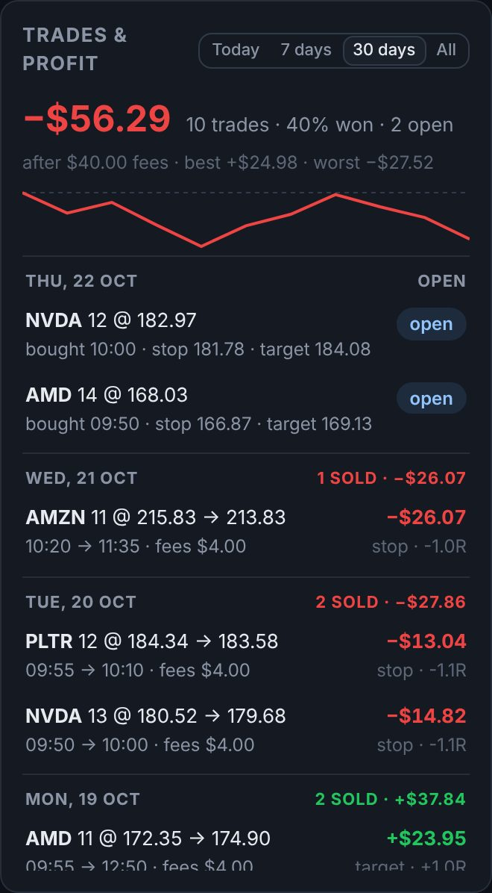<br><b>Trades &amp; profit.</b> Every buy and sell of today, the last 7 or 30 days, or all time: the profit of each trade, of each day, and in total after fees.</td>
<td>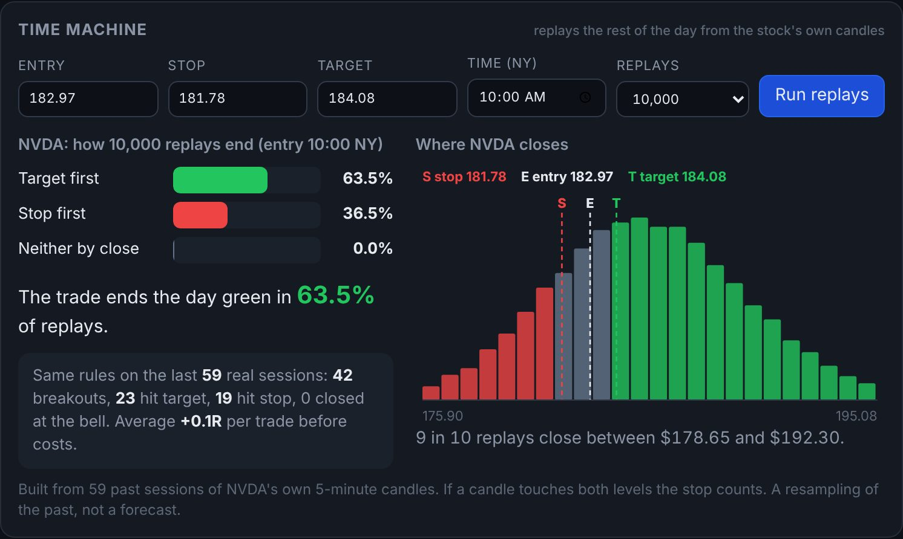<br><b>Time Machine.</b> It replays the rest of the day 10,000 times from the stock's own past sessions: how often the target comes first, how often the stop, and where the stock closes.</td>
</tr>
</table>

---

## The 11 agents

traday is one program, but it works like the team in the reel: eleven small agents, each with one
job, woken in turn by the Autopilot. The **Agents** page in the dashboard and the apps shows them working live.

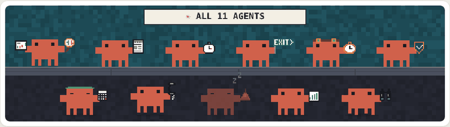

| # | Agent | Its job | Where in the code |
| --- | --- | --- | --- |
| 1 | **Chart Scanner** (chart + magnifier) | Draws each stock's opening range (9:30 – 9:45) and drops ranges too tight or too wide. | `strategy.py` |
| 2 | **News Monitor** (newspaper) | Reads the headlines; earnings, downgrades, SEC, halts get a **!** and go to your phone. | `news.py` |
| 3 | **Entry Timer** (stopwatch) | Buys at the close of the first 5-minute candle above the range, before 11:30. Never chases a missed one. | `strategy.py`, `engine.py` |
| 4 | **Exit Planner** (EXIT sign) | Plans the way out before the buy: stop at the range middle, target 1R, sell-by 15:50. | `strategy.py` |
| 5 | **Time Machine** (goggles + pocket watch) | Replays the rest of the day 10,000 times from the stock's last 59 sessions. | `timemachine.py` |
| 6 | **Risk Manager** (shield) | Says yes or no: kill switch, limits, daily loss, and whether the profit is worth the fees. | `risk.py` |
| 7 | **Accountant** (visor + calculator) | How many shares, the fees and currency costs, cash, P&L and the journal. | `risk.py`, `journal.py` |
| 8 | **Order Executor** (phone) | Places the orders: paper, or DEGIRO with a real stop-loss resting at DEGIRO. | `brokers/` |
| 9 | **Alerts** (bell) | Rings your phone (ntfy or Telegram) at every buy, sell, skip and error. | `notify.py` |
| 10 | **Backtester** (bar chart) | Runs the same rules on the last 59 sessions, now also after costs. | `strategy.py` |
| 11 | **Position Watcher** (binoculars) | Watches open trades, sees DEGIRO's stop fills, sells leftovers at the next open. | `engine.py` |

Each card shows what that agent is doing right now ("Watching AMD, NVDA every 20 s", "Blocked MSFT:
2 positions open"). Click one for everything about it: its job, your own settings for it, when it
works, what it said in the example trade, the Claude phrase that reaches it, and its code.

**Watch one trade** plays the reel's TSLA morning candle by candle. Each agent tells its part, and
every number comes from traday's own engine running that morning:

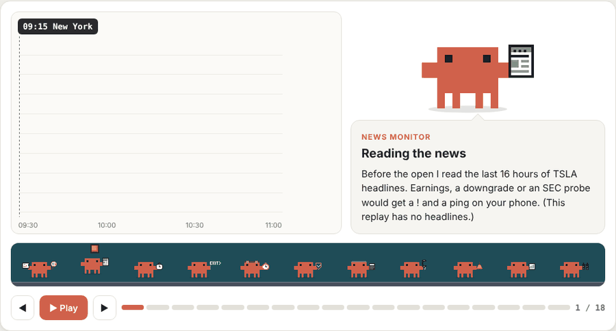

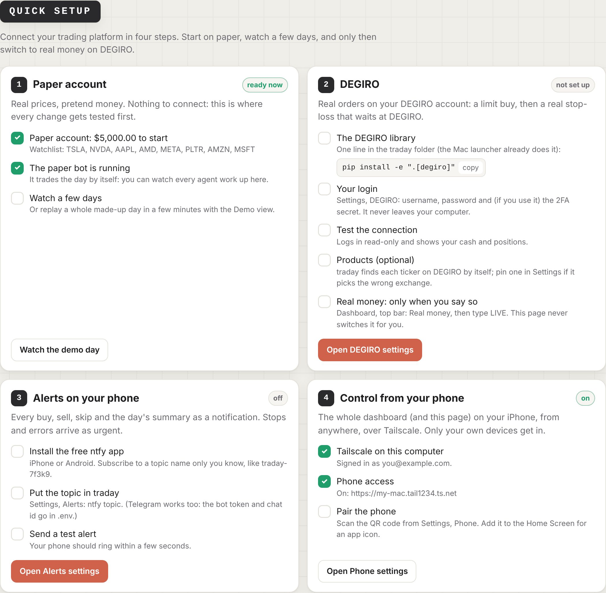

**Quick setup** connects your trading platform in four steps, each with live checks and a button:

1. **Paper account:** ready at once. Start the paper bot.
2. **DEGIRO:** the library, your login (in `.env` or the Mac Keychain), **Test the connection**,
   optional pinned products. Real money stays behind typing **LIVE**.
3. **Alerts:** the ntfy topic and **Send a test alert**.
4. **Your phone:** Tailscale and the pairing code.

<br clear="right">

---

## Review every trade and the profit

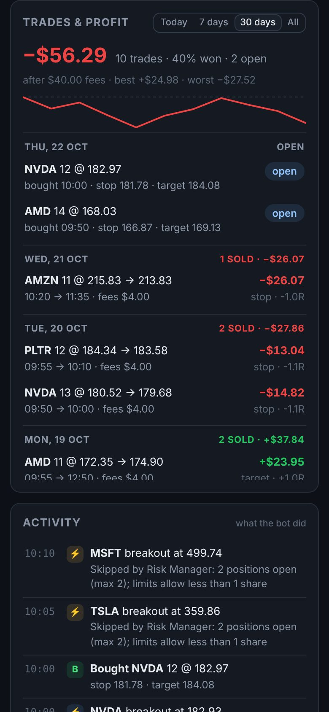

The **Trades & profit** card (right column on the computer, the **Trades** tab in the apps) lists
every buy and sell:

- **each trade:** stock, shares, buy price and time, sell price and time, why it sold (target,
  stop, the 15:50 close, your Close button, the kill switch), fees, profit in dollars and in R
- **each day:** how many trades, and the day's profit after fees
- **the total** for today, 7 days, 30 days or all time: profit after fees, win rate, best and
  worst trade, and a line of the running profit

It reads the journal the bot writes, so it is the same on the web page, the Mac and the iPhone, and
it survives restarts.

<br clear="right">

---

## How it works

One setup, the same five rules every day. All times are New York time.

1. **Opening range:** the highest and lowest price from 9:30 to 9:45 form a box.
2. **Entry:** buy when a 5-minute candle **closes** above the box, before 11:30. A quick poke above
   the line does not count.
3. **Stop:** the middle of the box. If the price falls back there, the trade is wrong.
4. **Target:** the same distance above the entry as the stop is below it (1R).
5. **Time exit:** whatever is still open is sold at 15:50.

```
 9:00  News Monitor      headlines for the watchlist; the market-moving ones go to your phone
 9:30  Chart Scanner     builds each stock's opening range (9:30-9:45)
 9:45  Entry Timer       waits for a 5-min candle to CLOSE above the range high (until 11:30)
       Exit Planner      stop = range middle, target = 1x risk, sell-by 15:50
       Time Machine      (when you ask) the rest of the day replayed 10,000x
       Backtester        (when you ask) the same rules on the last 59 sessions
       Risk Manager      yes or no: kill switch, limits, daily loss, profit vs fees
       Accountant        how many shares; fees, cash, P&L, the journal
       Order Executor    paper fill, or DEGIRO: limit buy -> real stop-loss order at DEGIRO
       Alerts            "BUY TSLA 5 @ 364.18 | stop 358.32 | target 370.04" on your phone
       Position Watcher  checks the open trade every 20 s; sells at the target or the stop
15:50  Exit Planner      anything still open is sold; Accountant + Alerts: the day's summary
```

The reel's TSLA trade comes out of these rules to the cent. The range is 354.47 – 362.18, and the
10:10 candle closes at 364.18. So the bot buys at 364.18, with the stop at 358.32 and the target at
370.04 (`tests/test_strategy.py` checks it).

**Costs decide this strategy.** A 1R target usually aims for a 0.5 – 1% move. From a euro account,
DEGIRO's currency conversion alone takes about 0.5% per round trip, plus about €2 per order. That is
why the Risk Manager skips trades whose profit would be under 1.5× their costs, and why the paper
account charges the same fees.

---

## Will it make money?

**The software, yes, it works:** it scans, times, sizes, buys, protects, sells, logs and alerts as
described, on paper today, and every rule is covered by tests that replay hand-made trading days.
Three things have not been proven yet: a live run against a real DEGIRO account (the connection is
an unofficial library, so a DEGIRO change can break it), the first real build of the Mac and
iPhone apps, and the strategy itself on real prices.

**The strategy: with the default settings and a euro account, expect it to lose money slowly**,
unless your own backtest and paper trading show otherwise. The arithmetic, using the reel's own
TSLA trade and traday's default costs:

| | Before costs | After DEGIRO costs |
| --- | --- | --- |
| Target hit (5 shares, +$5.86 each) | +$29.30 | **+$16.20** |
| Stop hit (5 shares, −$5.86 each) | −$29.30 | **−$42.40** |
| Win rate needed to break even | 50% | **72%** |

The round trip costs about $13.10: $4 in order fees and $9.10 in currency conversion (0.25% each
way). That is 45% of the profit of a winning trade. Plain opening-range breakouts on big US stocks
usually win about half the time at 1R (the reel's own Time Machine showed 29% target-first against
26% stop-first). So the likely result is each trade losing about its costs: around −$13 a trade
at the default size, a few hundred dollars a month at 1–2 trades a day. The $60 daily loss limit
caps a bad day, not a bad month.

**What would change that, in order:**

1. **Measure, don't guess.** The backtester runs each stock on the watchlist and prints the result
   **after costs**, sized exactly like the bot. Then paper-trade
   until **Trades & profit** shows at least 50–100 trades. Only a positive total after fees counts.
2. **Cut the currency cost.** It is the largest cost. Holding US dollars in the account instead of
   converting on every trade brings the break-even win rate from 72% down to about 57%. Check
   DEGIRO's current fee page for how to keep a USD balance.
3. **Only then think about size.** Bigger positions shrink the €2 order fees, not the currency
   cost, and they make every loss bigger.

Treat traday as a disciplined tool that follows your rules without emotion, and a lab that shows
in numbers whether a rule works. Don't treat it as a money machine. The reel's "make winning
trades" is a highlight, not a track record.

---

## Background

This started from an @opusjake reel about "the Trader skill", a free pack of Claude skills
(github.com/Jakeschincariol/trader-skill). The reel shows a day-trading version with 11 skills drawn
as pixel critters (Chart Scanner, News Monitor, Entry Timer, Exit Planner, Time Machine, Risk
Manager, Order Executor and more); traday's [11 agents](#the-11-agents) are drawn after them. The public
repository today is a different, investing-oriented v1.0 that only prepares orders for Alpaca or
IBKR and never places them itself.

traday rebuilds the day-trading parts from scratch for DEGIRO and adds an autopilot, a paper
broker, a dashboard, a trade history, a Mac app, an iPhone app and tests. It keeps the safety rules: paper first,
hard limits and a kill switch.

The reel's own example is worth a second look: the target was hit first in 29.4% of replays, the
stop first in 25.5%, and neither in 45%. That is an honest picture of this kind of setup: a small
edge at best, and fees decide whether it is positive.

## License

© 2026 Christo Dontchev. All rights reserved. The source code is private and is not licensed for
use, copying or distribution; see [LICENSE](LICENSE).
